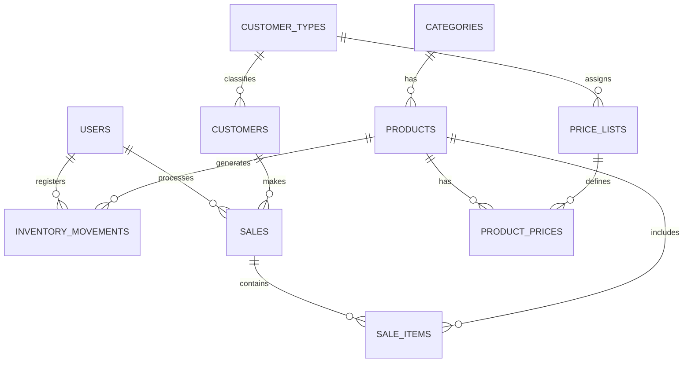

# Diseño de Arquitectura - Sistema POS Básico

## 1. Estructura de Base de Datos

### 1.1 Diagrama Entidad-Relación (Mermaid)



### 1.2 Tablas y Definiciones

#### **Tabla: customer_types** (Catálogo de tipos de cliente)
```sql
CREATE TABLE customer_types (
    id              SERIAL PRIMARY KEY,
    code            VARCHAR(20) UNIQUE NOT NULL,      -- 'REGULAR', 'WHOLESALE', 'VIP'
    name            VARCHAR(100) NOT NULL,
    description     TEXT,
    discount_percent DECIMAL(5,2) DEFAULT 0.00,       -- Descuento base por tipo
    is_active       BOOLEAN DEFAULT TRUE,
    created_at      TIMESTAMP DEFAULT CURRENT_TIMESTAMP,
    updated_at      TIMESTAMP DEFAULT CURRENT_TIMESTAMP
);
```

#### **Tabla: customers** (Clientes)
```sql
CREATE TABLE customers (
    id                  SERIAL PRIMARY KEY,
    customer_type_id    INTEGER REFERENCES customer_types(id) ON DELETE SET NULL,
    document_type       VARCHAR(20),                   -- 'DNI', 'RUC', 'PASSPORT'
    document_number     VARCHAR(30) UNIQUE,
    business_name       VARCHAR(200),                  -- Razón social (empresas)
    first_name          VARCHAR(100),
    last_name           VARCHAR(100),
    email               VARCHAR(150),
    phone               VARCHAR(30),
    address             TEXT,
    credit_limit        DECIMAL(12,2) DEFAULT 0.00,
    current_balance     DECIMAL(12,2) DEFAULT 0.00,
    is_active           BOOLEAN DEFAULT TRUE,
    created_at          TIMESTAMP DEFAULT CURRENT_TIMESTAMP,
    updated_at          TIMESTAMP DEFAULT CURRENT_TIMESTAMP
);

CREATE INDEX idx_customers_document ON customers(document_number);
CREATE INDEX idx_customers_type ON customers(customer_type_id);
```

#### **Tabla: categories** (Categorías de productos)
```sql
CREATE TABLE categories (
    id          SERIAL PRIMARY KEY,
    parent_id   INTEGER REFERENCES categories(id) ON DELETE SET NULL, -- Subcategorías
    code        VARCHAR(20) UNIQUE NOT NULL,
    name        VARCHAR(100) NOT NULL,
    description TEXT,
    is_active   BOOLEAN DEFAULT TRUE,
    created_at  TIMESTAMP DEFAULT CURRENT_TIMESTAMP
);
```

#### **Tabla: products** (Productos)
```sql
CREATE TABLE products (
    id              SERIAL PRIMARY KEY,
    category_id     INTEGER REFERENCES categories(id) ON DELETE SET NULL,
    sku             VARCHAR(50) UNIQUE NOT NULL,
    barcode         VARCHAR(50) UNIQUE,
    name            VARCHAR(200) NOT NULL,
    description     TEXT,
    unit_of_measure VARCHAR(20) DEFAULT 'UNI',          -- UNI, KG, LT, M, etc.
    cost_price      DECIMAL(12,4) DEFAULT 0.0000,       -- Precio de costo (4 decimales)
    stock_min       INTEGER DEFAULT 0,
    stock_max       INTEGER DEFAULT 0,
    is_active       BOOLEAN DEFAULT TRUE,
    is_service      BOOLEAN DEFAULT FALSE,              -- True = servicio (no stock)
    created_at      TIMESTAMP DEFAULT CURRENT_TIMESTAMP,
    updated_at      TIMESTAMP DEFAULT CURRENT_TIMESTAMP
);

CREATE INDEX idx_products_category ON products(category_id);
CREATE INDEX idx_products_sku ON products(sku);
CREATE INDEX idx_products_barcode ON products(barcode);
```

#### **Tabla: price_lists** (Listas de precios)
```sql
CREATE TABLE price_lists (
    id                  SERIAL PRIMARY KEY,
    customer_type_id    INTEGER REFERENCES customer_types(id) ON DELETE CASCADE,
    name                VARCHAR(100) NOT NULL,
    description         TEXT,
    applies_from        DATE DEFAULT CURRENT_DATE,
    applies_to          DATE,                           -- NULL = indefinido
    is_default          BOOLEAN DEFAULT FALSE,
    is_active           BOOLEAN DEFAULT TRUE,
    created_at          TIMESTAMP DEFAULT CURRENT_TIMESTAMP,
    updated_at          TIMESTAMP DEFAULT CURRENT_TIMESTAMP
);

CREATE UNIQUE INDEX uq_price_list_type_default 
    ON price_lists(customer_type_id) 
    WHERE is_default = TRUE;
```

#### **Tabla: product_prices** (Precios por producto y lista)
```sql
CREATE TABLE product_prices (
    id              SERIAL PRIMARY KEY,
    price_list_id   INTEGER REFERENCES price_lists(id) ON DELETE CASCADE,
    product_id      INTEGER REFERENCES products(id) ON DELETE CASCADE,
    sale_price      DECIMAL(12,4) NOT NULL,             -- Precio de venta (4 decimales)
    min_quantity    INTEGER DEFAULT 1,                  -- Cantidad mínima para este precio
    is_active       BOOLEAN DEFAULT TRUE,
    created_at      TIMESTAMP DEFAULT CURRENT_TIMESTAMP,
    updated_at      TIMESTAMP DEFAULT CURRENT_TIMESTAMP,
    
    UNIQUE(price_list_id, product_id, min_quantity)
);

CREATE INDEX idx_product_prices_product ON product_prices(product_id);
CREATE INDEX idx_product_prices_list ON product_prices(price_list_id);
```

#### **Tabla: inventory** (Stock actual - tabla denormalizada para performance)
```sql
CREATE TABLE inventory (
    product_id      INTEGER PRIMARY KEY REFERENCES products(id) ON DELETE CASCADE,
    quantity_on_hand DECIMAL(12,4) DEFAULT 0.0000,
    quantity_reserved DECIMAL(12,4) DEFAULT 0.0000,     -- Reservado en ventas pendientes
    last_movement_at TIMESTAMP,
    updated_at      TIMESTAMP DEFAULT CURRENT_TIMESTAMP
);
```

#### **Tabla: inventory_movements** (Kardex / Movimientos de inventario)
```sql
CREATE TABLE inventory_movements (
    id              BIGSERIAL PRIMARY KEY,
    product_id      INTEGER REFERENCES products(id) ON DELETE RESTRICT,
    movement_type   VARCHAR(20) NOT NULL,               -- 'IN', 'OUT', 'ADJUSTMENT', 'TRANSFER', 'RETURN'
    reference_type  VARCHAR(30),                        -- 'PURCHASE', 'SALE', 'ADJUSTMENT', 'RETURN'
    reference_id    BIGINT,                             -- ID de compra, venta, ajuste
    quantity        DECIMAL(12,4) NOT NULL,             -- Positivo = entrada, Negativo = salida
    unit_cost       DECIMAL(12,4) DEFAULT 0.0000,       -- Costo unitario al momento
    running_balance DECIMAL(12,4) NOT NULL,             -- Saldo después del movimiento
    notes           TEXT,
    user_id         INTEGER REFERENCES users(id) ON DELETE SET NULL,
    created_at      TIMESTAMP DEFAULT CURRENT_TIMESTAMP
);

CREATE INDEX idx_inventory_movements_product ON inventory_movements(product_id);
CREATE INDEX idx_inventory_movements_date ON inventory_movements(created_at);
CREATE INDEX idx_inventory_movements_ref ON inventory_movements(reference_type, reference_id);
```

#### **Tabla: users** (Usuarios del sistema)
```sql
CREATE TABLE users (
    id              SERIAL PRIMARY KEY,
    username        VARCHAR(50) UNIQUE NOT NULL,
    email           VARCHAR(150) UNIQUE NOT NULL,
    password_hash   VARCHAR(255) NOT NULL,
    full_name       VARCHAR(200) NOT NULL,
    role            VARCHAR(30) NOT NULL,               -- 'ADMIN', 'CASHIER', 'MANAGER', 'INVENTORY'
    is_active       BOOLEAN DEFAULT TRUE,
    last_login      TIMESTAMP,
    created_at      TIMESTAMP DEFAULT CURRENT_TIMESTAMP,
    updated_at      TIMESTAMP DEFAULT CURRENT_TIMESTAMP
);
```

#### **Tabla: sales** (Ventas / Facturas)
```sql
CREATE TABLE sales (
    id                  BIGSERIAL PRIMARY KEY,
    sale_number         VARCHAR(30) UNIQUE NOT NULL,    -- Número correlativo
    customer_id         INTEGER REFERENCES customers(id) ON DELETE SET NULL,
    customer_type_id    INTEGER REFERENCES customer_types(id) ON DELETE SET NULL, -- Snapshot
    price_list_id       INTEGER REFERENCES price_lists(id) ON DELETE SET NULL,    -- Snapshot
    user_id             INTEGER REFERENCES users(id) ON DELETE SET NULL,
    subtotal            DECIMAL(12,4) NOT NULL DEFAULT 0.0000,
    discount_amount     DECIMAL(12,4) DEFAULT 0.0000,
    tax_amount          DECIMAL(12,4) DEFAULT 0.0000,
    total_amount        DECIMAL(12,4) NOT NULL DEFAULT 0.0000,
    paid_amount         DECIMAL(12,4) DEFAULT 0.0000,
    change_amount       DECIMAL(12,4) DEFAULT 0.0000,
    payment_method      VARCHAR(30),                    -- 'CASH', 'CARD', 'TRANSFER', 'CREDIT', 'MIXED'
    payment_reference   VARCHAR(100),                   -- Nº tarjeta, transferencia, etc.
    status              VARCHAR(20) DEFAULT 'COMPLETED',-- 'PENDING', 'COMPLETED', 'CANCELLED', 'REFUNDED'
    notes               TEXT,
    sold_at             TIMESTAMP DEFAULT CURRENT_TIMESTAMP,
    created_at          TIMESTAMP DEFAULT CURRENT_TIMESTAMP,
    updated_at          TIMESTAMP DEFAULT CURRENT_TIMESTAMP
);

CREATE INDEX idx_sales_customer ON sales(customer_id);
CREATE INDEX idx_sales_date ON sales(sold_at);
CREATE INDEX idx_sales_status ON sales(status);
CREATE INDEX idx_sales_number ON sales(sale_number);
```

#### **Tabla: sale_items** (Detalle de venta)
```sql
CREATE TABLE sale_items (
    id                  BIGSERIAL PRIMARY KEY,
    sale_id             BIGINT REFERENCES sales(id) ON DELETE CASCADE,
    product_id          INTEGER REFERENCES products(id) ON DELETE RESTRICT,
    product_name        VARCHAR(200) NOT NULL,          -- Snapshot nombre
    product_sku         VARCHAR(50) NOT NULL,           -- Snapshot SKU
    unit_price          DECIMAL(12,4) NOT NULL,         -- Precio unitario aplicado
    quantity            DECIMAL(12,4) NOT NULL,
    discount_percent    DECIMAL(5,2) DEFAULT 0.00,
    discount_amount     DECIMAL(12,4) DEFAULT 0.0000,
    tax_percent         DECIMAL(5,2) DEFAULT 0.00,
    tax_amount          DECIMAL(12,4) DEFAULT 0.0000,
    line_total          DECIMAL(12,4) NOT NULL,
    cost_price          DECIMAL(12,4) DEFAULT 0.0000,   -- Costo al momento (para margen)
    created_at          TIMESTAMP DEFAULT CURRENT_TIMESTAMP
);

CREATE INDEX idx_sale_items_sale ON sale_items(sale_id);
CREATE INDEX idx_sale_items_product ON sale_items(product_id);
```

---

## 2. Flujo Lógico del Sistema

### 2.1 Flujo Principal: Proceso de Venta

```
┌─────────────────────────────────────────────────────────────────────────────┐
│                         FLUJO DE VENTA (CHECKOUT)                            │
└─────────────────────────────────────────────────────────────────────────────┘

1. INICIO VENTA
   ├─ Usuario selecciona "Nueva Venta"
   ├─ Sistema crea venta en estado 'PENDING'
   └─ Asigna número correlativo (sale_number)

2. IDENTIFICACIÓN CLIENTE (Opcional)
   ├─ Buscar por: DNI/RUC, nombre, teléfono
   ├─ Si existe → Cargar customer_type_id y price_list_id
   ├─ Si no existe → Cliente "CONSUMIDOR FINAL" (tipo REGULAR)
   └─ Guardar snapshot de customer_type_id y price_list_id en venta

3. AGREGAR PRODUCTOS (Loop)
   ├─ Escanear código de barras / Buscar por SKU/nombre
   ├─ Validar: producto activo, stock disponible
   ├─ OBTENER PRECIO:
   │   ├─ Buscar en product_prices donde price_list_id = venta.price_list_id
   │   │   AND product_id = producto AND min_quantity <= cantidad
   │   │   ORDER BY min_quantity DESC LIMIT 1
   │   ├─ Si no hay precio en lista → Usar precio base del producto
   │   └─ Aplicar descuentos por volumen si corresponde
   ├─ Calcular línea: (unit_price * quantity) - discount + tax
   ├─ Validar stock: inventory.quantity_on_hand >= quantity
   ├─ Reservar stock: inventory.quantity_reserved += quantity
   ├─ Agregar a sale_items
   └─ Actualizar totales de venta (subtotal, discount, tax, total)

4. REVISIÓN Y AJUSTES
   ├─ Aplicar descuento global (si permitido por rol)
   ├─ Cambiar método de pago
   ├─ Aplicar pagos mixtos (efectivo + tarjeta)
   └─ Calcular vuelto

5. CONFIRMACIÓN Y CIERRE
   ├─ Validar: paid_amount >= total_amount
   ├─ TRANSACCIÓN BD (Atómica):
   │   ├─ UPDATE sales SET status='COMPLETED', paid_amount=..., change_amount=...
   │   ├─ UPDATE inventory: quantity_on_hand -= quantity, quantity_reserved -= quantity
   │   ├─ INSERT inventory_movements (tipo 'OUT', reference='SALE', reference_id=sale_id)
   │   ├─ UPDATE customers: current_balance += total_amount (si crédito)
   │   └─ COMMIT
   ├─ Imprimir ticket / Enviar por email
   └─ Limpiar carrito → Listo para nueva venta

6. MANEJO DE ERRORES
   ├─ Stock insuficiente → Alertar, permitir venta parcial o cancelar línea
   ├─ Pago rechazado → Mantener venta PENDING, reintentar
   ├─ Error BD → Rollback completo, alertar usuario
   └─ Cancelación → Liberar stock reservado, marcar venta 'CANCELLED'
```

### 2.2 Flujo: Gestión de Inventario (Entradas)

```
┌─────────────────────────────────────────────────────────────────────────────┐
│                      ENTRADA DE MERCADERÍA (COMPRAS)                         │
└─────────────────────────────────────────────────────────────────────────────┘

1. REGISTRO DE COMPRA
   ├─ Proveedor, fecha, número de factura/guía
   ├─ Líneas: producto, cantidad, costo unitario
   └─ Validar: producto activo, costo >= 0

2. PROCESAMIENTO (Transacción)
   ├─ Por cada línea:
   │   ├─ UPDATE products SET cost_price = nuevo_costo (opcional: promedio ponderado)
   │   ├─ UPDATE inventory: quantity_on_hand += cantidad
   │   ├─ INSERT inventory_movements (tipo 'IN', reference='PURCHASE')
   │   └─ Calcular running_balance
   └─ COMMIT

3. ACTUALIZACIÓN DE PRECIOS (Opcional)
   ├─ Si cambió costo → Sugerir recálculo de precios de venta
   ├─ Aplicar margen por categoría/tipo cliente
   └─ Generar nueva versión de price_list si corresponde
```

### 2.3 Flujo: Ajustes de Inventario

```
┌─────────────────────────────────────────────────────────────────────────────┐
│                         AJUSTES DE INVENTARIO                                │
└─────────────────────────────────────────────────────────────────────────────┘

TIPOS: MERMA, SOBRANTE, TRANSFERENCIA, DEVOLUCIÓN PROVEEDOR, INVENTARIO FÍSICO

1. SELECCIÓN TIPO Y MOTIVO
2. AGREGAR PRODUCTOS CON CANTIDAD (Positiva/Negativa)
3. VALIDAR: Stock resultante >= 0 (salvo mermas autorizadas)
4. TRANSACCIÓN:
   ├─ UPDATE inventory
   ├─ INSERT inventory_movements (tipo 'ADJUSTMENT')
   └─ COMMIT
5. REGISTRO DE USUARIO AUTORIZADOR (para auditoría)
```

### 2.4 Flujo: Clasificación de Clientes y Precios

```
┌─────────────────────────────────────────────────────────────────────────────┐
│                    LÓGICA DE PRECIOS POR TIPO CLIENTE                        │
└─────────────────────────────────────────────────────────────────────────────┘

AL CREAR/EDITAR CLIENTE:
1. Asignar customer_type_id (REGULAR, WHOLESALE, VIP, etc.)
2. Sistema asigna automáticamente price_list_id por defecto del tipo

AL PROCESAR VENTA:
1. Obtener price_list_id del cliente (snapshot en venta)
2. Para cada producto:
   SELECT pp.sale_price
   FROM product_prices pp
   JOIN price_lists pl ON pp.price_list_id = pl.id
   WHERE pp.product_id = ? 
     AND pl.customer_type_id = venta.customer_type_id
     AND pp.is_active = TRUE
     AND pl.is_active = TRUE
     AND pp.min_quantity <= cantidad_vendida
   ORDER BY pp.min_quantity DESC
   LIMIT 1

3. FALLBACK: Si no hay precio en lista → products.cost_price * margen_default

ESQUEMA DE DESCUENTOS POR VOLUMEN (en product_prices):
- min_quantity = 1   → Precio unitario normal
- min_quantity = 10  → Precio por mayor (10+ unidades)
- min_quantity = 50  → Precio distribuidor (50+ unidades)
```

### 2.5 Flujo: Reportes

```
┌─────────────────────────────────────────────────────────────────────────────┐
│                              MÓDULO DE REPORTES                              │
└─────────────────────────────────────────────────────────────────────────────┘

REPORTE 1: VENTAS POR PERÍODO
- Filtros: fecha_inicio, fecha_fin, usuario, cliente, tipo_cliente, estado
- Métricas: total_ventas, ticket_promedio, items_vendidos, margen_bruto
- Agrupación: día, semana, mes, vendedor, cliente

REPORTE 2: MOVIMIENTOS DE INVENTARIO (KARDEX)
- Filtros: producto, categoría, tipo_movimiento, fecha_inicio, fecha_fin
- Columnas: fecha, tipo, referencia, entrada, salida, saldo, costo_unitario, valor_total
- Valorización: FIFO / Promedio Ponderado / Último Costo

REPORTE 3: STOCK ACTUAL Y ALERTAS
- Productos con stock <= stock_min (Punto de pedido)
- Productos sin movimiento > N días
- Valorización de inventario (costo / venta)

REPORTE 4: BALANCE DE INGRESOS
- Ingresos brutos por período
- Descuentos concedidos
- Impuestos recolectados
- Ventas al crédito vs contado
- Cuentas por cobrar (clientes con saldo > 0)

REPORTE 5: RANKING PRODUCTOS / CLIENTES
- Top 20 productos por cantidad / ingresos / margen
- Top 20 clientes por compras / frecuencia / ticket promedio
- Análisis ABC de productos (Pareto 80/20)
```

---

## 3. Recomendaciones de Stack Tecnológico

### 3.1 Opción A: Stack Moderno Full-Stack JavaScript/TypeScript (Recomendado para Agilidad)

| Capa | Tecnología | Justificación |
|------|------------|---------------|
| **Frontend** | **React 18+ / Next.js 14** (App Router) | SSR/SSG, SEO, componentes reutilizables, ecosistema maduro |
| **Estado UI** | **Zustand** o **Redux Toolkit** | Simple, performante, TypeScript nativo |
| **UI Library** | **Shadcn/UI + Tailwind CSS** | Accesible, personalizable, cero dependencias runtime |
| **Forms/Validación** | **React Hook Form + Zod** | Type-safe, performante, esquema compartido FE/BE |
| **Backend** | **Node.js 20+ / Fastify** o **Hono** | Alto rendimiento, bajo overhead, TypeScript nativo |
| **API** | **tRPC** o **GraphQL (Pothos)** | End-to-end type safety, sin codegen manual |
| **ORM** | **Prisma ORM** | Type-safe DB access, migraciones, seeding, Studio UI |
| **Base de Datos** | **PostgreSQL 15+** | ACID, JSONB, índices parciales, CTEs, window functions |
| **Cache/Sesiones** | **Redis 7+** (ioredis) | Sesiones, rate limiting, cache de precios/stock |
| **Auth** | **NextAuth.js v5** o **Better Auth** | Múltiples providers, RBAC, edge-ready |
| **Tiempo Real** | **Socket.io** o **Pusher** | Stock en vivo, notificaciones, multi-caja |
| **Testing** | **Vitest** (unit) + **Playwright** (E2E) | Rápido, TypeScript nativo, coverage integrado |
| **Deploy** | **Vercel** (FE) + **Railway/Render/Fly.io** (BE) | Zero-config, preview deployments, autoscaling |
| **Observabilidad** | **Sentry** + **Logtail/Pino** | Error tracking, logging estructurado, performance |

**Ventajas para implementación ágil:**
- Un solo lenguaje (TypeScript) en toda la pila
- Compartir tipos/interfaces entre FE y BE (tRPC/Prisma)
- Hot reload en desarrollo (Turbopack/Next.js)
- Deployments atómicos con preview por PR
- Ecosistema enorme de componentes y hooks

---

### 3.2 Opción B: Stack Python (Si el equipo prefiere Python)

| Capa | Tecnología |
|------|------------|
| **Backend** | **FastAPI** + **SQLAlchemy 2.0** + **Pydantic v2** |
| **Frontend** | **React/Next.js** (separado) o **Reflex** (Python full-stack) |
| **DB** | **PostgreSQL** + **AsyncPG** |
| **Admin UI** | **SQLAdmin** o **AdminLTE** |
| **Tasks** | **Celery** + **Redis** |
| **Deploy** | **Docker** + **Kubernetes** (K3s) o **Fly.io** |

---

### 3.3 Opción C: Stack .NET (Entornos empresariales Microsoft)

| Capa | Tecnología |
|------|------------|
| **Backend** | **ASP.NET Core 8** + **Entity Framework Core** |
| **Frontend** | **Blazor WebAssembly** o **React** |
| **DB** | **PostgreSQL** / **SQL Server** |
| **Real-time** | **SignalR** |
| **Deploy** | **Azure Container Apps** / **AKS** |

---

## 4. Consideraciones Arquitectónicas Clave

### 4.1 Patrones Recomendados

```
┌─────────────────────────────────────────────────────────────────────────────┐
│                         ARQUITECTURA POR CAPAS                               │
└─────────────────────────────────────────────────────────────────────────────┘

┌──────────────────┐
│   PRESENTATION   │  → React Components, Pages, Hooks
│   (Next.js App)  │
└────────┬─────────┘
         │ tRPC / REST
┌────────▼─────────┐
│    APPLICATION   │  → Use Cases, Services, DTOs, Validators
│   (Services)     │
└────────┬─────────┘
         │ Repository Interface
┌────────▼─────────┐
│     DOMAIN       │  → Entities, Value Objects, Domain Events, Rules
│   (Core Logic)   │
└────────┬─────────┘
         │ Repository Implementation
┌────────▼─────────┐
│  INFRASTRUCTURE  │  → Prisma/PostgreSQL, Redis, Email, Payment Gateways
│  (Adapters)      │
└──────────────────┘
```

### 4.2 Decisiones Críticas

| Decisión | Recomendación | Razón |
|----------|---------------|-------|
| **Concurrencia stock** | **Optimistic Locking** (version column) + **Reservas** | Evita overselling sin bloqueos largos |
| **Precios históricos** | **Snapshot en sale_items** | Auditoría, recálculos, devoluciones exactas |
| **Soft Delete** | `deleted_at` timestamp en tablas maestras | Recuperación, integridad referencial |
| **Auditoría** | Tabla `audit_logs` + Triggers PG o Prisma Middleware | Trazabilidad completa |
| **Multi-tenancy** | `tenant_id` en todas las tablas (si aplica) | Escalabilidad futura |
| **Moneda** | Almacenar en centavos (INTEGER) o DECIMAL(19,4) | Evitar errores float |
| **Zonas horarias** | UTC en BD, zona local en UI | Consistencia global |

### 4.3 Seguridad

```typescript
// Principios mínimos
- JWT con refresh tokens rotativos (HttpOnly cookies)
- RBAC: ADMIN > MANAGER > CASHIER > INVENTORY
- Rate limiting: 100 req/min por IP, 10 login/min
- Validación Zod en TODAS las entradas (FE + BE)
- Sanitización HTML en notas/descripciones (DOMPurify)
- CORS restrictivo, CSP headers
- Encriptación en tránsito (TLS 1.3) y reposo (PG crypto)
- Logs sin datos sensibles (PII, tarjetas)
```

---

## 5. Roadmap de Implementación Sugerido

### Fase 1: Core MVP (2-3 semanas)
- [ ] Setup proyecto (Next.js + tRPC + Prisma + PostgreSQL)
- [ ] Auth + RBAC básico
- [ ] CRUD Productos, Categorías, Clientes, Tipos Cliente
- [ ] Listas de precios + Precios por volumen
- [ ] Inventario básico (stock, movimientos IN/OUT)
- [ ] POS: Carrito, selección cliente, cálculo precios, cierre venta
- [ ] Ticket impresión (thermal printer ESC/POS)

### Fase 2: Operaciones (1-2 semanas)
- [ ] Compras/Entradas de inventario
- [ ] Ajustes de inventario + Kardex
- [ ] Devoluciones / Anulación ventas
- [ ] Cuentas por cobrar (clientes crédito)
- [ ] Cierre de caja (arqueo)
- [ ] Reportes básicos (ventas, stock, kardex)

### Fase 3: Robustez (1-2 semanas)
- [ ] Tests unitarios + E2E (cobertura >80%)
- [ ] Optimistic locking + manejo concurrencia
- [ ] Auditoría completa + logs estructurados
- [ ] Backup automático + Point-in-time recovery
- [ ] Monitoreo (Sentry, health checks)
- [ ] Documentación API (OpenAPI/Swagger)

### Fase 4: Escalabilidad (Continuo)
- [ ] Multi-sucursal / Multi-almacén
- [ ] Integración contable (SIAF, contabilidad)
- [ ] E-commerce sync (Woocommerce, Shopify)
- [ ] App móvil (React Native / Expo)
- [ ] Analytics avanzados (Metabase / Apache Superset)

---

## 6. Estructura de Carpetas Sugerida (Next.js + tRPC + Prisma)

```
pos-system/
├── .github/workflows/          # CI/CD
├── prisma/
│   ├── schema.prisma           # Esquema BD completo
│   ├── migrations/             # Migraciones versionadas
│   └── seed.ts                 # Datos iniciales
├── src/
│   ├── app/                    # Next.js App Router
│   │   ├── (auth)/             # Login, register, layout
│   │   ├── (dashboard)/        # Layout autenticado
│   │   │   ├── pos/            # Interfaz POS
│   │   │   ├── inventory/      # Gestión inventario
│   │   │   ├── customers/      # Clientes
│   │   │   ├── products/       # Productos
│   │   │   ├── reports/        # Reportes
│   │   │   └── settings/       # Configuración
│   │   └── api/                # API routes (webhooks, etc.)
│   ├── components/             # Componentes React compartidos
│   │   ├── ui/                 # Shadcn/UI components
│   │   ├── pos/                # Componentes específicos POS
│   │   └── forms/              # Formularios reutilizables
│   ├── server/                 # Backend (tRPC + Services)
│   │   ├── api/                # Routers tRPC
│   │   │   ├── product.ts
│   │   │   ├── customer.ts
│   │   │   ├── sale.ts
│   │   │   ├── inventory.ts
│   │   │   └── report.ts
│   │   ├── services/           # Lógica de negocio
│   │   │   ├── pricing.service.ts
│   │   │   ├── inventory.service.ts
│   │   │   └── sale.service.ts
│   │   ├── repositories/       # Data access (Prisma wrappers)
│   │   ├── utils/              # Helpers server-only
│   │   └── db.ts               # Prisma client singleton
│   ├── lib/                    # Utilidades compartidas FE/BE
│   │   ├── validations/        # Esquemas Zod
│   │   ├── constants/          # Enums, constantes
│   │   └── utils.ts            # Helpers generales
│   ├── hooks/                  # Custom React hooks
│   ├── stores/                 # Zustand stores
│   ├── types/                  # Tipos TypeScript compartidos
│   └── styles/                 # Globales, Tailwind config
├── docker-compose.yml          # Dev environment (PG, Redis)
├── Dockerfile
├── package.json
├── tsconfig.json
├── tailwind.config.ts
└── README.md
```

---

## 7. Próximos Pasos Inmediatos

1. **Inicializar repositorio** con la estructura arriba
2. **Definir `schema.prisma`** completo basado en las tablas del §1.2
3. **Configurar Docker Compose** con PostgreSQL 15 + Redis 7
4. **Implementar migración inicial** y seed de datos maestros:
   - Tipos cliente: REGULAR, WHOLESALE, VIP
   - Categorías base
   - Usuario admin inicial
   - Lista de precios por defecto por tipo
5. **Setup tRPC + Prisma** con tipado end-to-end
6. **Crear primer router**: `product.router.ts` (CRUD completo)
7. **UI Base**: Layout, Sidebar, Auth pages con NextAuth

---

*Documento generado para el proyecto POS - Yuselania*
*Fecha: 2025-11-25*